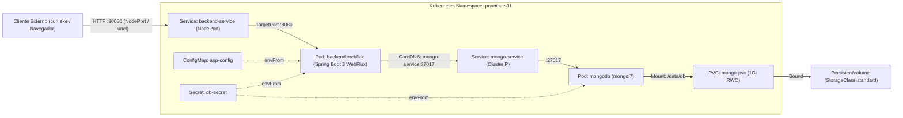

# Práctica Calificada de Kubernetes: Persistencia y Comunicación Multi-componente

Arquitectura cloud-native desplegada en **Kubernetes (Minikube)** dentro del namespace `practica-s11`. Compuesta por un microservicio reactivo en **Spring Boot 3 (WebFlux, Java 17)** y **MongoDB 7** con almacenamiento persistente (`PersistentVolumeClaim`), externalización de configuración (`ConfigMap`), credenciales codificadas en Base64 (`Secret`), descubrimiento interno por DNS (`CoreDNS` / `ClusterIP`) y exposición externa mediante `NodePort`.

---

## Diagrama de Arquitectura



---

## Estructura del Repositorio

```text
.
├── .gitignore
├── README.md
├── INFORME.md
├── GUION_VIDEO.md
├── evidencias/
│   ├── 01-estado-cluster.txt
│   ├── 02-describe-pvc.txt
│   ├── 03-env-backend.txt
│   ├── 04-crud-post-get.txt
│   └── 05-prueba-persistencia.txt
├── k8s/
│   ├── 00-namespace.yaml        # Namespace: practica-s11
│   ├── 01-mongo-pvc.yaml        # PVC: mongo-pvc (1Gi, ReadWriteOnce)
│   ├── 02-app-configmap.yaml    # ConfigMap: app-config (DB_HOST=mongo-service, DB_PORT=27017, DB_NAME, APP_PORT=8080)
│   ├── 03-db-secret.yaml        # Secret Opaque en Base64 (MONGO_INITDB_ROOT_USERNAME y PASSWORD)
│   ├── 04-mongo-stack.yaml      # Deployment (mongo:7, Recreate) + Service ClusterIP (mongo-service:27017)
│   └── 05-backend-stack.yaml    # Deployment (backend-webflux:1.0, probes, resources) + Service NodePort (backend-service:30080)
└── src/
    ├── Dockerfile               # Multi-stage build (maven:3.9.6-eclipse-temurin-17 -> eclipse-temurin:17-jre-alpine)
    ├── pom.xml                  # Spring Boot 3.2.5 (WebFlux, Reactive MongoDB, Actuator)
    └── src/main/
        ├── java/com/practica/s11/
        │   ├── S11WebfluxApplication.java
        │   ├── controller/ProductoController.java
        │   ├── model/Producto.java
        │   └── repository/ProductoRepository.java
        └── resources/
            └── application.yml  # Configuración parametrizada 100% mediante variables de entorno
```

---

## Cómo Desplegar (Windows PowerShell)

### 1. Iniciar Minikube
```powershell
minikube status
minikube start --driver=docker
```

### 2. Construir la imagen del Backend con Docker y cargarla en Minikube
```powershell
docker build -t backend-webflux:1.0 ./src
minikube image load backend-webflux:1.0
```

### 3. Validar y aplicar los manifiestos de Kubernetes
```powershell
kubectl apply --dry-run=client -f k8s/
kubectl apply -f k8s/00-namespace.yaml
kubectl apply -f k8s/
```

### 4. Esperar a que los despliegues estén Ready
```powershell
kubectl rollout status deployment/mongo-deployment -n practica-s11 --timeout=120s
kubectl rollout status deployment/backend-deployment -n practica-s11 --timeout=180s
kubectl get all,pvc,configmaps,secrets -n practica-s11
```

---

## Cómo Probar (Windows PowerShell)

### Opción A: Exposición mediante `kubectl port-forward` (URL fija para navegador y `curl.exe`)
En una ventana de PowerShell, ejecuta:
```powershell
kubectl port-forward svc/backend-service -n practica-s11 8080:8080
```
- **URL en el navegador / Postman:**
  - `http://localhost:8080/api/productos`
  - `http://localhost:8080/actuator/health`

### Opción B: Túnel de NodePort en Minikube (Windows + driver Docker)
En una ventana de PowerShell dedicada (debe permanecer abierta mientras dure la prueba):
```powershell
minikube service backend-service -n practica-s11 --url
```
Usa la URL devuelta (ej. `http://127.0.0.1:<PUERTO>`) en el navegador o con `curl.exe`.

### Pruebas CRUD con `curl.exe`
```powershell
# Crear productos (POST)
curl.exe -i -X POST "http://localhost:8080/api/productos" `
  -H "Content-Type: application/json" `
  -d "{\"nombre\": \"Laptop Lenovo ThinkPad P16\", \"precio\": 1850.50}"

curl.exe -i -X POST "http://localhost:8080/api/productos" `
  -H "Content-Type: application/json" `
  -d "{\"nombre\": \"Monitor Dell UltraSharp 27\", \"precio\": 499.99}"

# Listar todos los productos (GET)
curl.exe -s "http://localhost:8080/api/productos"
```

### Prueba de Persistencia
```powershell
# 1. Eliminar el pod de MongoDB
kubectl delete pod -l app=mongo -n practica-s11

# 2. Esperar a que el nuevo pod esté Ready
kubectl wait --for=condition=ready pod -l app=mongo -n practica-s11 --timeout=120s

# 3. Verificar que los productos siguen almacenados en el PVC
curl.exe -s "http://localhost:8080/api/productos"
```

---

## Cómo Limpiar el Entorno

```powershell
kubectl delete namespace practica-s11
```
